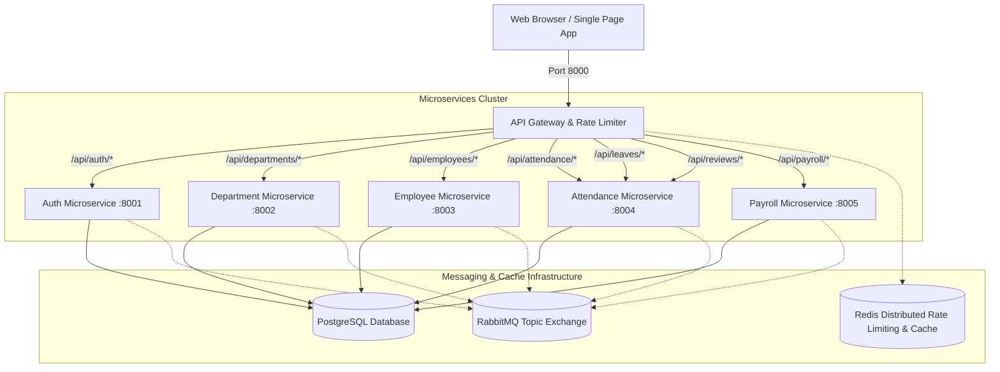

# 🏢 NexusHR — Distributed Microservices Employee Management Platform


A production-grade, cloud-native, distributed microservices platform for enterprise employee lifecycle, departmental hierarchy, attendance tracking, performance management, and automated payroll calculations. Built with **Python FastAPI**, **SQLAlchemy**, **PostgreSQL**, **Redis**, **RabbitMQ**, **Docker**, **Kubernetes**, and a modern **Glassmorphic Single Page Application Dashboard**.

---

## 📐 Architecture Overview



---

## 📦 Services Breakdown & Port Map

| Microservice | Port | Database | Primary Responsibilities |
| :--- | :--- | :--- | :--- |
| **API Gateway** | `8000` | Redis (Cache/Limiter) | Reverse proxy routing, JWT token inspection, global rate limiting, health check aggregation |
| **Auth Service** | `8001` | PostgreSQL / SQLite | User authentication, password hashing (PBKDF2-HMAC-SHA256, 600k iterations), JWT generation, RBAC roles |
| **Department Service** | `8002` | PostgreSQL / SQLite | Department lifecycle, organizational structure, managerial assignments, annual budgeting |
| **Employee Service** | `8003` | PostgreSQL / SQLite | Employee profiles, job titles, department mappings, skill tracking, compensation records |
| **Attendance Service** | `8004` | PostgreSQL / SQLite | Daily clock-in/out, work hours calculation, leave requests, manager approvals, performance reviews |
| **Payroll Service** | `8005` | PostgreSQL / SQLite | Salary structure, tax withholdings, allowances, pension deductions, batch payslip generation |
| **Web Dashboard** | `3000` | NGINX / Static | Glassmorphic single page application with live service topology, org chart, payroll simulator |

---

## 🔐 Role-Based Access Control (RBAC) Default Accounts

The platform automatically seeds demo accounts for instant testing:

| Role | Username | Password | Access Scope |
| :--- | :--- | :--- | :--- |
| **ADMIN** | `admin` | `admin123` | Full access across all microservices, deletion rights, batch payroll |
| **HR_MANAGER** | `hrmanager` | `hr123` | Employee onboarding, leave approvals, salary adjustments, payroll runs |
| **DEPT_MANAGER** | `deptmanager` | `manager123` | Department updates, subordinate reviews, leave recommendations |
| **EMPLOYEE** | `employee` | `emp123` | Self profile view, check-in/out, personal leave applications |

---

## 🚀 Quick Start Guide

### Option 1: Local Multi-Process Mode (Fastest)

Run all microservices concurrently using the automated python runner:

```bash
# 1. Install dependencies
pip install -r requirements.txt

# 2. Start all microservices + API gateway
python scripts/start_local.py

# 3. Open the Frontend Dashboard
# Simply open frontend/index.html in any modern web browser or serve it:
cd frontend && python -m http.server 3000
```

### Option 2: Docker Compose (Production-Grade Stack)

Start the entire distributed architecture with PostgreSQL, Redis, RabbitMQ, all 6 microservices, and NGINX:

```bash
docker compose up --build
```

- **Frontend Web Dashboard**: [http://localhost:3000](http://localhost:3000)
- **API Gateway**: [http://localhost:8000](http://localhost:8000)
- **RabbitMQ Management Dashboard**: [http://localhost:15672](http://localhost:15672) (User: `guest`, Pass: `guest`)

---

## 🔑 Secrets Setup (Required Before Docker/K8s Deployment)

> [!IMPORTANT]
> The `JWT_SECRET` **must** be set to a cryptographically random value before any Docker Compose or Kubernetes deployment. Never use the placeholder values from source control in a real environment.

### Docker Compose

```bash
# 1. Copy the environment template
cp .env.example .env

# 2. Generate a cryptographically random 256-bit JWT secret and write it to .env
python -c "import secrets; print('JWT_SECRET=' + secrets.token_hex(32))" >> .env

# 3. Optionally set a strong Postgres password in .env as well

# 4. Launch (Docker Compose automatically reads .env)
docker compose up --build
```

### Kubernetes

```bash
# Replace the CHANGE_ME placeholder in k8s/configmap-secrets.yaml with a generated secret:
# python -c "import secrets; print(secrets.token_hex(32))"
#
# For production clusters, use a secrets manager (Vault, AWS Secrets Manager, Sealed Secrets)
# instead of committing values to configmap-secrets.yaml at all.
```

---

## ☸️ Kubernetes Deployment

Deploy the entire microservice ecosystem to any Kubernetes cluster:

```bash
# 1. Create Namespace
kubectl apply -f k8s/namespace.yaml

# 2. Apply ConfigMap and Secrets
kubectl apply -f k8s/configmap-secrets.yaml

# 3. Deploy Data Tier (Postgres, Redis, RabbitMQ)
kubectl apply -f k8s/postgres.yaml
kubectl apply -f k8s/redis-rabbitmq.yaml

# 4. Deploy All Microservices & Gateway
kubectl apply -f k8s/services-deployments.yaml

# 5. Deploy Frontend and Ingress
kubectl apply -f k8s/frontend-ingress.yaml

# Verify all pods are running
kubectl get pods -n nexus-hr
```

---

## 🧪 Running Automated Tests

Run the complete integration and unit test suite across all services:

```bash
python -m pytest tests/ -v
```

---

## 📚 API Endpoints Reference

### API Gateway (`http://localhost:8000`)
- `GET /health` — Gateway status
- `GET /api/gateway/services-status` — Real-time health & latency of all 5 downstream microservices

### Auth Service (`/api/auth/*`)
- `POST /api/auth/login` — Authenticate and receive JWT access token
- `POST /api/auth/register` — Register a new account
- `GET /api/auth/me` — Current authenticated user profile
- `GET /api/auth/users` — List all registered users (Admin / HR only)

### Department Service (`/api/departments/*`)
- `GET /api/departments` — List all active departments
- `GET /api/departments/stats` — Total count, active count, total budget
- `POST /api/departments` — Create a new department
- `PUT /api/departments/{id}` — Update department details
- `DELETE /api/departments/{id}` — Delete a department

### Employee Service (`/api/employees/*`)
- `GET /api/employees` — Search, filter by department/status, and paginate employees
- `GET /api/employees/stats` — Total headcount, department breakdown, avg salary
- `GET /api/employees/{id}` — Get single employee profile
- `POST /api/employees` — Create new employee profile (Publishes `employee.created` event)
- `PUT /api/employees/{id}` — Update employee details (Publishes `employee.updated` event)
- `DELETE /api/employees/{id}` — Delete employee profile (Publishes `employee.deleted` event)

### Attendance & Leaves Service (`/api/attendance/*`, `/api/leaves/*`, `/api/reviews/*`)
- `GET /api/attendance/overview` — Today's attendance counts and pending leaves
- `POST /api/attendance/check-in` — Check in employee for the day
- `POST /api/attendance/check-out` — Check out and record total working hours
- `GET /api/leaves` — List all leave applications
- `POST /api/leaves` — Submit a leave request (Publishes `leave.requested` event)
- `PUT /api/leaves/{id}/review` — Approve or reject leave request
- `GET /api/reviews` — List performance reviews
- `POST /api/reviews` — Create new performance review

### Payroll Service (`/api/payroll/*`)
- `GET /api/payroll/metrics` — Monthly gross/net disbursement metrics & tax withholding
- `GET /api/payroll/payslips` — List generated payslips for period
- `GET /api/payroll/structures` — List employee salary structures
- `POST /api/payroll/generate` — Generate itemized payslip for an employee
- `POST /api/payroll/batch-run` — Execute batch payroll calculation across all active employees

---

## 📊 Final Verification Matrix

| Component | Static Validation | Runtime Validation | Result | Evidence |
| :--- | :--- | :--- | :--- | :--- |
| **Tests** | **VERIFIED** (AST / Imports) | **VERIFIED** (`pytest`) | **VERIFIED** | 42 passed, 0 failed (incl. 7 Active On Duty lifecycle tests) |
| **Auth Service** | **VERIFIED** (Models / Schemas) | **VERIFIED** (Port 8001 / Container) | **VERIFIED** | Salted PBKDF2-HMAC-SHA256 (600k iter), JWT generation & `/auth/me` return HTTP 200 |
| **Department Service** | **VERIFIED** (CRUD / Hierarchy) | **VERIFIED** (Port 8002 / Container) | **VERIFIED** | `/departments`, `/departments/stats` return HTTP 200 |
| **Employee Service** | **VERIFIED** (Profiles / Directory) | **VERIFIED** (Port 8003 / Container) | **VERIFIED** | Directory search, stats, CRUD & RBAC return HTTP 200/201 |
| **Attendance Service** | **VERIFIED** (Workflows / Time) | **VERIFIED** (Port 8004 / Container) | **VERIFIED** | Clock-in/out, leave requests & approvals return HTTP 200/201; `GET /attendance/on-duty/count` live verified; Active On Duty lifecycle (check-in → +1, check-out → 0) confirmed |
| **Payroll Service** | **VERIFIED** (Structures / Math) | **VERIFIED** (Port 8005 / Container) | **VERIFIED** | Payslips, metrics & batch run return HTTP 200/201 |
| **API Gateway** | **VERIFIED** (Proxy / Limiter) | **VERIFIED** (Port 8000 / Container) | **VERIFIED** | Reverse routing, status aggregation & Redis rate limiter live verified |
| **Frontend Dashboard** | **VERIFIED** (HTML / JS / CSS) | **VERIFIED** (Port 3000 / NGINX) | **VERIFIED** | Glassmorphic UI & Gateway API integration live verified (HTTP 200) |
| **Docker Compose** | **VERIFIED** (`compose config`) | **VERIFIED** (`docker compose ps`) | **VERIFIED** | All 10/10 containers running and healthy |
| **PostgreSQL** | **VERIFIED** (Connection strings) | **VERIFIED** (`nexus-postgres`) | **VERIFIED** | Container healthy, migrations & persistent data verified |
| **Redis** | **VERIFIED** (Client / URL) | **VERIFIED** (`nexus-redis`) | **VERIFIED** | Gateway Redis rate-limiting connected and functional |
| **RabbitMQ** | **VERIFIED** (Exchange / Topic) | **VERIFIED** (`nexus-rabbitmq`) | **VERIFIED** | AMQP :5672 & Management :15672 running and operational |
| **Kubernetes** | **VERIFIED** (25 YAML docs) | **NOT RUNTIME VERIFIED** | **STATICALLY VERIFIED** | All manifests statically valid; no active Kubernetes cluster connected |
| **CI/CD** | **VERIFIED** (`ci.yml` paths) | **VERIFIED** (Automated syntax) | **VERIFIED** | GitHub Actions pipeline syntax and build context paths verified |

---

## 🛡️ Security Best Practices

- Standard JWT Bearer token authentication with configurable expiration.
- Role-based server-side access control with RBAC enforcement (`ADMIN`, `HR_MANAGER`, `DEPT_MANAGER`, `EMPLOYEE`).
- Passwords hashed with **PBKDF2-HMAC-SHA256 at 600,000 iterations** (current OWASP minimum), using a per-password 128-bit random salt; legacy SHA-256 hashes are automatically upgraded to PBKDF2 on next login.
- `JWT_SECRET` **must** be set via environment variable to a cryptographically random value (`secrets.token_hex(32)`, 256 bits) before any non-local deployment. The code fallback is a development convenience only and must never be used in production.
- Cross-Origin Resource Sharing (CORS) configured for enterprise microservice clients.
- Distributed Redis rate-limiting (300 requests/min per client IP) to guard against API flooding and DoS.
- Isolated databases per service in production PostgreSQL with individual schemas / connection pools.
